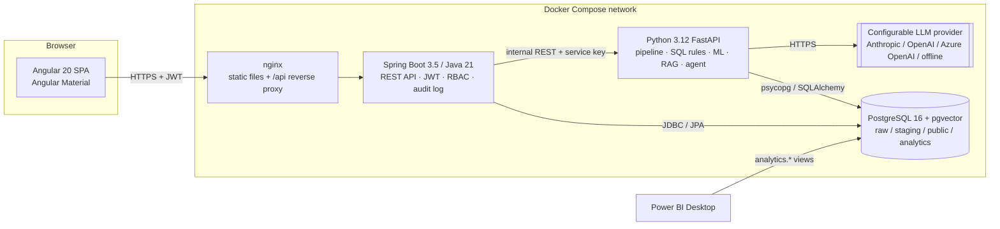

# AuditIQ – System Architecture

## 1. Guiding principles

| Principle | How it is applied |
|---|---|
| Single entry point | The Angular SPA talks **only** to the Spring Boot API. The Python service is internal and never exposed to the browser. RBAC is therefore enforced in one place. |
| One source of truth for schema | Flyway migrations in the backend own the PostgreSQL schema. The Python service reads/writes the same database but never alters its structure. |
| Layered data | `raw` → `staging` → `public` (curated) → `analytics` (Power BI views). |
| Few moving parts | PostgreSQL with **pgvector** is both the relational store and the vector database – no separate ChromaDB container. |
| Human in the loop | AI output is labelled, stored with its sources, and can never change an investigation's outcome. Only an authorised user can record outcomes. |
| Azure-ready | Every service is a stateless container configured purely by environment variables (maps 1:1 to Azure Container Apps + Azure Database for PostgreSQL Flexible Server + Key Vault). |

## 2. Component diagram

## 3. Responsibilities

| Component | Responsibilities |
|---|---|
| **Angular SPA** | Login, route guards by role, overview, transactions, pipeline, exceptions, risk analytics, investigations, AI assistant/agent UI, reports, administration. |
| **Spring Boot API** | Authentication (JWT access + rotating refresh tokens), user/role management, audit logging of every significant action, investigation workflow (state machine, notes, assignment, human-reviewed outcome), read APIs over curated data, orchestration calls to the Python service, OpenAPI docs. |
| **Python service** | Synthetic data generator, ingestion/validation pipeline, SQL audit-rule engine, Isolation Forest training/scoring/evaluation, document ingestion + embeddings, RAG answering with citations, tool-restricted investigation agent. |
| **PostgreSQL** | Relational data, data layers, pgvector embeddings, analytical views for Power BI. |

## 4. Request flow examples

**Login** – SPA `POST /api/auth/login` → Spring validates BCrypt hash → issues 15‑min access JWT + 7‑day refresh token (stored SHA‑256 hashed, rotated on use) → `audit_logs` row `LOGIN_SUCCESS`.

**Run pipeline (Phase 2)** – SPA → `POST /api/pipeline/run` (Spring checks role, writes audit log) → `POST http://analytics-service:8000/internal/pipeline/run` with `X-Service-Key` → Python writes `pipeline_runs` / `data_quality_reports`.

**AI investigation (Phase 7)** – Spring → Python agent; the agent can call only an allow-list of read-only tools; its report is saved as `investigation_evidence` with `ai_generated = true` and `human_review_status = PENDING`.

## 5. Security model

* Stateless JWT (HS256, secret from env, min 256‑bit) – access tokens short-lived; refresh tokens revocable.
* BCrypt (strength 12) password hashing, account lock after 5 failed attempts for 15 minutes.
* Method-level `@PreAuthorize` + URL rules. Roles: `ADMIN`, `AUDITOR`, `AUDIT_MANAGER`.
* Service-to-service shared key between API and Python service; the Python service is not published to the host in production.
* Self-registration disabled by default (`AUDITIQ_SELF_REGISTRATION=false`); users are created by an Administrator.
* No secrets in source – `.env` is git-ignored, `.env.example` documents every variable.

## 6. Azure mapping (future)

| Local | Azure |
|---|---|
| Docker Compose services | Azure Container Apps (one app per service) |
| PostgreSQL + pgvector | Azure Database for PostgreSQL Flexible Server (pgvector extension is supported) |
| `.env` | Azure Key Vault + Container Apps secrets |
| GitHub Actions | GitHub Actions → Azure Container Registry → Container Apps |
| Logs to stdout | Azure Monitor / Log Analytics |
