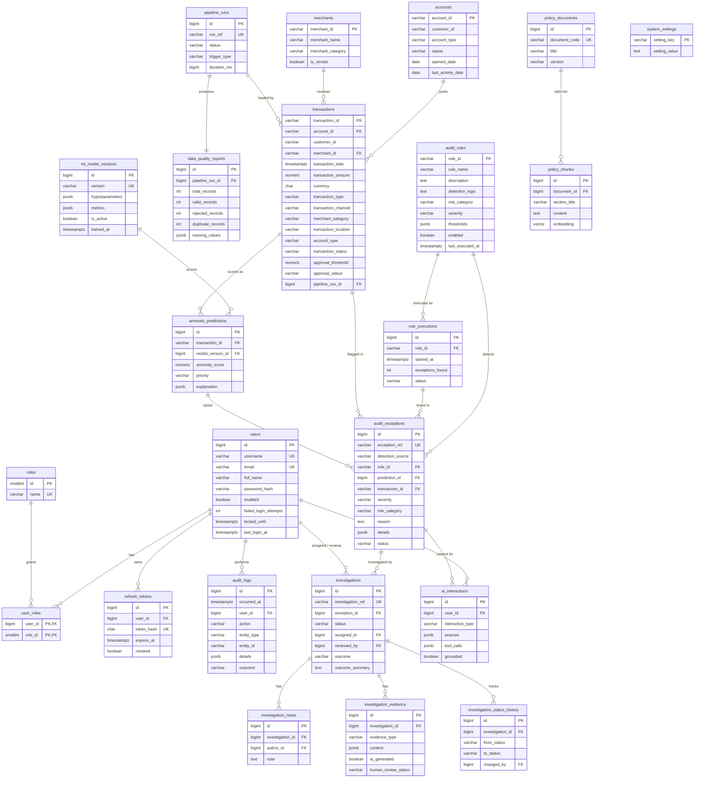

# AuditIQ – Database ERD

Schema is managed by Flyway (`backend/src/main/resources/db/migration`). Monetary values use `NUMERIC(18,2)`; all timestamps are `TIMESTAMPTZ`.

## Data layers

| Schema | Purpose |
|---|---|
| `raw` | Data exactly as received (all text columns) + lineage (`pipeline_run_id`, `source_file`, `source_row`). |
| `staging` | Typed, standardised rows with validation status and rejection reasons. |
| `public` | Curated, normalised operational model used by the application. |
| `analytics` | Read-only views for the Angular dashboards and Power BI (Phase 5). |

## Curated model

## Notes

* **Ground truth** for ML evaluation lives in `raw.synthetic_anomaly_labels` – deliberately separated from the curated `transactions` table so labels never leak into the features or the auditor UI.
* `policy_chunks.embedding` is created in the Phase 6 migration once the embedding dimension is fixed by the chosen provider.
* `audit_exceptions` has a partial unique index on `(rule_id, transaction_id)` so re-running a rule is idempotent.
* `investigations.version` provides optimistic locking for concurrent status changes.
