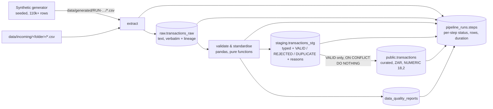

# Phase 2 – Data engineering

## Flow

* **Trigger:** `POST /api/pipeline/run` (Administrator or Auditor; audited) → Spring Boot → internal
  `POST /internal/pipeline/runs` on the analytics service. Runs are asynchronous; the UI polls the step log.
* **One run at a time:** enforced by a partial unique index on `pipeline_runs` (a second request gets HTTP 409).
* **Atomic load:** raw → staging → curated → report is one database transaction. Any failure rolls the data back and
  the run is recorded as `FAILED` with the failing step and error.
* **Restart safety:** runs left `RUNNING` by a service restart are marked `FAILED` at start-up.
* **Scheduling:** `PIPELINE_SCHEDULE_MINUTES>0` enables an interval scheduler (`trigger_type = SCHEDULED`). Airflow
  would replace this in production; the runner API is the same.
* **Retention:** raw rows older than `retention.raw_layer_days` (system setting) are purged at the end of each run.

## Synthetic dataset

`python -m app.pipeline.cli --seed 42 --transactions 110000 --out data/incoming/sample` writes `transactions.csv`,
`accounts.csv`, `merchants.csv` and `labels.csv`.

| Element | Detail |
|---|---|
| Population | 8,000 accounts (cheque / savings / credit / business; ~6% dormant), 600 merchants (~20% B2B vendors) – fixed reference seed, identical across runs |
| Period | 12 calendar months (1 Nov 2025 – 31 Oct 2026), local time SAST |
| Normal activity | account-type-specific mixes of purchases, transfers, withdrawals, deposits, debit orders and vendor payments; category-specific log-normal amounts; daily/hourly seasonality |
| Approval thresholds | cheque/savings R50k, credit R30k, business R250k |

**Injected anomalies** (ground truth in `raw.synthetic_anomaly_labels`, never exposed in curated tables or the UI):

| Type | Pattern (seed 42, 110k) |
|---|---|
| `DUPLICATE_PAYMENT` | same account, amount and day, minutes apart (250) |
| `LARGE_TRANSACTION` | 1.5–40× normal, ~30% bypassing approval (150) |
| `SPLIT_TRANSACTION` | 3–5 payments at 80–99% of the threshold within hours, together above it (≈480) |
| `HIGH_FREQUENCY` | 15–30 small card/online payments within an hour (≈770) |
| `DORMANT_ACCOUNT_ACTIVITY` | activity on accounts silent for 400+ days (≈150) |
| `UNUSUAL_VENDOR_PAYMENT` | 4–10× a vendor's usual amount, or a new vendor paid at 00:00–05:00 (≈160) |

**Injected data-quality defects** – the feed is deliberately imperfect: missing required values, non-numeric /
negative amounts, impossible and future dates, unknown accounts / merchants, invalid statuses, three date formats,
inconsistent category case, channel and type synonyms, lower-case / blank currencies, thousand separators, padded IDs,
foreign-currency amounts and re-sent duplicate records. Destructive defects are never applied to anomaly rows (or to
rows an anomaly depends on, such as the original of a duplicate payment), so ground truth stays exact.

## Validation and standardisation rules

| Rule | Outcome |
|---|---|
| Required fields (`transaction_id`, `account_id`, `customer_id`, `transaction_date`, `transaction_amount`, type, channel, account type, status) | `MISSING_<FIELD>` → rejected |
| Date parses as `YYYY-MM-DD HH:MM:SS` / `DD/MM/YYYY HH:MM:SS` (SAST) or ISO-8601 UTC | stored as UTC `timestamptz`; else `INVALID_DATE`; > now+1 day `FUTURE_DATE` |
| Amount numeric (thousand separators removed), ≥ 0, ≤ R100m | `INVALID_AMOUNT`, `NEGATIVE_AMOUNT`, `IMPLAUSIBLE_AMOUNT` |
| Currency upper-cased; blank → ZAR; converted with `fx.*` system settings | original amount and currency kept for lineage |
| Type / channel / status / account type mapped through synonym tables to controlled vocabularies | `INVALID_*` |
| Account exists; customer and account type match master data | `UNKNOWN_ACCOUNT`, `CUSTOMER_ACCOUNT_MISMATCH`, `ACCOUNT_TYPE_MISMATCH` |
| Merchant required for purchases / vendor payments / debit orders and must exist | `MISSING_MERCHANT`, `UNKNOWN_MERCHANT` |
| Category taken from merchant master (enriches blanks, corrects spelling) | `INVALID_CATEGORY` if no merchant and unknown category |
| Transaction ID repeated in the batch or already curated | `DUPLICATE` (counted separately from rejections) |

## Results (seed 42, 110,000 requested)

| Metric | Value |
|---|---|
| Records received | 112,386 |
| Valid → curated | 111,009 (98.77%) |
| Rejected (with reasons) | 945 |
| Duplicate records | 432 |
| Missing values | 5,048 |
| End-to-end duration (Docker on a laptop) | ≈ 35 s |

## Tests

* `tests/test_generator.py` – volume, determinism, every anomaly type present and internally consistent, defects present.
* `tests/test_validation.py` – each rule, every date format, synonyms, FX, enrichment, duplicates, reconciliation.
* `tests/integration/test_pipeline_db.py` – real PostgreSQL: all layers loaded and reconciled, idempotent re-run,
  CSV ingestion, failure recording, mid-run rollback, single-active-run guard, request validation.
* Backend `PipelineIntegrationTest` / `TransactionIntegrationTest` – RBAC, auditing, 409/503 mapping, filters,
  whitelisted sorting, injection-safe parameters, lineage.
