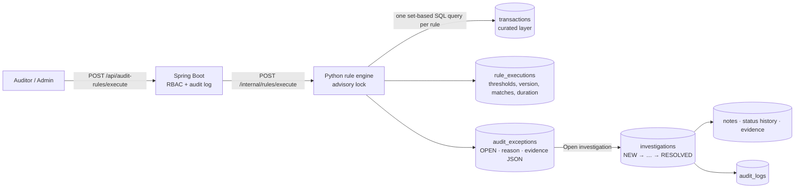

# Phase 3 – Audit analytics and investigation management

## Flow



* **Findings are potential exceptions.** Reasons are factual ("same account, amount and business date as …") and the UI
  labels every finding as requiring human review. Nothing in the system concludes wrongdoing.
* **Configuration, not code.** Thresholds live in `audit_rules.thresholds`, validated against
  `audit_rules.threshold_schema` by both the API (on save) and the engine (before every run). Administrators edit them
  under *Administration → Audit rules*; each save increments the rule version and is audited with before/after values.
* **Traceability.** Each exception stores the rule version and the exact thresholds that produced it, links to its
  `rule_executions` row (batch reference, who ran it, when), and carries evidence JSON (matched transactions, measured
  values).
* **Idempotent, isolated runs.** A transaction already flagged by a rule is not flagged again, so exceptions and their
  investigation state survive re-runs. Each rule runs in its own transaction, so one failing rule (recorded as `FAILED`
  with its error) never affects the others. A PostgreSQL advisory lock allows one execution at a time (HTTP 409).

## Rules

| ID | Rule | Category | Default severity | Detection (defaults) |
|---|---|---|---|---|
| AR-001 | Duplicate payments | Payment integrity | Medium (High ≥ R25k) | Same account, amount and SAST business date; every payment after the first is flagged with the matched transaction |
| AR-002 | Unusually large transactions | Approval control | High (Critical when unapproved) | ≥ 1.5 × the approval threshold, or ≥ threshold without `APPROVED` status |
| AR-003 | Transaction splitting | Approval control | High | ≥ 2 debits each 60–100% of the threshold within ±24 h, totalling more than the threshold |
| AR-004 | High-frequency transactions | Transaction monitoring | Medium (High at 2 × limit) | ≥ 10 transactions (including failed attempts) within 60 minutes; every transaction in the burst is flagged |
| AR-005 | Dormant account activity | Account control | High | First activity after ≥ 365 days of inactivity, follow-up activity within 90 days, or any activity on an account marked `DORMANT` |
| AR-006 | Unusual vendor payments | Vendor management | Medium (High when > 1 trigger) | ≥ 3 × the vendor's median payment; ≥ 4 payments to a vendor in 14 days at ≥ 3 × the account's usual rate; or ≥ R50k off-hours (00:00–05:00) within 30 days of the first payment to a vendor |

### Measured against the injected anomalies (seed 42, 111,009 curated transactions)

The ground-truth labels are used only for measurement. The rules never read them.

| Rule | Flagged | Matching injected type | Other injected anomalies | Not injected |
|---|---|---|---|---|
| AR-001 | 250 | 250 / 250 | 0 | 0 |
| AR-002 | 155 | 150 / 150 | 5 | 0 |
| AR-003 | 493 | 479 / 479 | 13 | 1 |
| AR-004 | 769 | 769 / 769 | 0 | 0 |
| AR-005 | 162 | 149 / 149 | 5 | 8 |
| AR-006 | 264 | 157 / 157 | 90 | 17 |

All six rules run in about 7 seconds in total. The "other injected anomalies" column shows overlapping patterns: a
large payment to a vendor is also an unusual vendor payment. Phase 4 compares these results with the Isolation Forest
model.

## Investigation workflow

```
NEW ─► UNDER_REVIEW ◄─► AWAITING_EVIDENCE
 │         ▲  │              │
 └──────► ESCALATED ◄────────┘          (escalation requires a reason)
UNDER_REVIEW / AWAITING_EVIDENCE / ESCALATED ─► RESOLVED   (assignee + outcome + summary ≥ 20 chars)
RESOLVED ─► UNDER_REVIEW                                   (re-open requires a reason)
```

* One investigation per exception. Opening one moves the exception to `UNDER_INVESTIGATION`, captures a snapshot of
  the flagged transaction and the rule result as evidence, and starts the status history.
* Outcomes (`NO_EXCEPTION`, `CONTROL_WEAKNESS`, `POLICY_BREACH`, `DATA_QUALITY_ISSUE`, `REFERRED_FOR_FURTHER_REVIEW`)
  are recorded only by a person, who is stored as the reviewer. Resolving closes the exception. A resolved case is
  read-only until it is re-opened; the previous outcome is kept in the history.
* Every change uses optimistic locking (`version`); a stale update returns HTTP 409 and the UI reloads the record.
* Assignees must be active auditors or audit managers.
* Audited actions: `AUDIT_RULES_EXECUTED`, `AUDIT_RULE_UPDATED`, `EXCEPTION_VIEWED`, `INVESTIGATION_CREATED`,
  `INVESTIGATION_ASSIGNED`, `INVESTIGATION_NOTE_ADDED`, `INVESTIGATION_STATUS_CHANGED`,
  `INVESTIGATION_OUTCOME_RECORDED`, `INVESTIGATION_REOPENED`. The investigation page shows its own audit trail.

## Access

| Action | Admin | Auditor | Audit manager |
|---|---|---|---|
| View rule catalogue and execution history | ✓ | ✓ | ✓ |
| Change thresholds / severity / enable | ✓ | | |
| Run audit rules | ✓ | ✓ | |
| View exceptions | | ✓ | ✓ |
| Open, assign, note, change status, record outcome | | ✓ | ✓ |

## API

`GET /api/audit-rules`, `GET /api/audit-rules/{id}`, `PUT /api/audit-rules/{id}`, `POST /api/audit-rules/execute`,
`GET /api/audit-rules/executions` · `GET /api/exceptions` (filters: severity, risk category, rule, status, account,
transaction date range, reference), `GET /api/exceptions/summary`, `GET /api/exceptions/{id}` ·
`GET|POST /api/investigations`, `GET /api/investigations/summary`, `GET /api/investigations/assignees`,
`GET /api/investigations/{id}`, `PUT /api/investigations/{id}/status`, `PUT /api/investigations/{id}/assignment`,
`POST /api/investigations/{id}/notes`. `POST /api/investigations/{id}/generate-report` arrives with the AI agent in
Phase 7.

## Tests

* Python: `tests/test_thresholds.py` (schema validation), `tests/integration/test_rules_db.py` (hand-built scenarios
  per rule, normal control account, idempotent re-run, configuration-driven thresholds, failing rule isolation, input
  validation, single-execution lock), `tests/integration/test_rules_dataset.py` (≥ 95% of every injected anomaly type
  recovered by its rule; < 10% of findings on unlabelled transactions).
* Backend: `InvestigationWorkflowTest`, `ThresholdValidatorTest`, `AuditRuleIntegrationTest` (catalogue, versioned and
  audited updates, validation, RBAC, execution, conflicts), `InvestigationIntegrationTest` (filters, detail evidence,
  the full lifecycle through outcome and re-open, optimistic locking, eligibility, RBAC).
* Frontend: exceptions list, exception detail, investigations list, investigation detail, audit-rules admin, facts
  helper.
