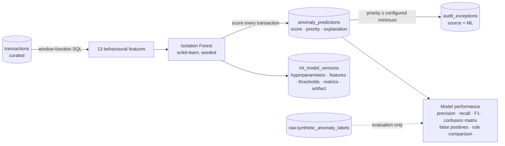

# Phase 4 – Machine-learning anomaly detection

## Flow

* **Unsupervised.** The model never reads the ground-truth labels; a test asserts the feature SQL does not touch
  them. Labels are used only to measure the model.
* **Score meaning.** The anomaly score is the Isolation Forest score `s(x) = 2^(-E[h(x)]/c(n))` in (0, 1). About 0.5
  or lower is ordinary; higher values are easier to isolate. It measures *unusualness*, **not** a probability of
  fraud, and every screen and exception says so.
* **Train** (`POST /api/ml/train`) fits a new version, scores every transaction, stores predictions and metrics, and
  makes the version active. Artifacts are saved to `data/models/<version>.joblib`. Training is reproducible for a
  given seed.
* **Detect** (`POST /api/ml/detect`) scores transactions loaded since training (using the full account history as
  context), re-applies the current thresholds, and raises one potential exception per flagged transaction at or above
  the configured minimum priority. It is idempotent.
* Only one train or detect run can happen at a time (PostgreSQL advisory lock, HTTP 409).

## Features

| Feature | What it captures |
|---|---|
| Transaction amount (log) | Size relative to all transactions |
| Amount ÷ approval threshold | Closeness to, or excess over, the approval limit |
| Amount vs account's other transactions | Leave-one-out z-score on log amounts (deviation from history) |
| Amount vs similar transactions | Log ratio to the median for the same category and type |
| Transactions in the preceding hour / 24 h | Frequency bursts |
| Time since previous activity (log hours) | Time between transactions, dormancy |
| Account activity level | Account's transaction count (activity pattern) |
| Channel rarity for the account | Unusual channel |
| Category rarity for the account | Unusual merchant category |
| Payee novelty | First or rare payment to a merchant or vendor |
| Night time (00:00–05:00 SAST) | Out-of-hours activity |
| Failed or reversed | Failed attempts |

**Explanations.** For each flagged transaction, every feature is compared with the training population using a robust
z-score (median and IQR). Up to three features at least one robust standard deviation from typical are listed, in
plain language built from the transaction's own values (for example "18 other transactions on the account in the
preceding hour"). When no single feature stands out, the largest one is shown and marked as a combination effect.
This is a transparent approximation, not a causal attribution.

## Thresholds (configurable under Administration → Anomaly model)

| Setting | Default | Meaning |
|---|---|---|
| `ml.anomaly_threshold` | 0.55 | Flag (LOW priority) |
| `ml.priority_threshold_medium` | 0.60 | MEDIUM priority |
| `ml.priority_threshold_high` | 0.65 | HIGH priority |
| `ml.exception_min_priority` | MEDIUM | Lowest priority that raises a potential exception |

Defaults were calibrated on the seed-42 dataset. LOW-priority flags stay visible as scores (on exceptions, transactions
and the performance report) but don't raise exceptions by default: only 15% of them are injected anomalies.

## Results (seed 42, 111,009 transactions, 1,954 injected anomalies)

| Metric | Value |
|---|---|
| ROC AUC / average precision | 0.987 / 0.832 |
| Flagged at ≥ 0.55 | 3,285 (precision 49.7%, recall 83.6%, F1 0.623) |
| HIGH band (≥ 0.65) | 979 flagged, precision 99.3% |
| MEDIUM band (0.60–0.65) | 575 flagged, precision 68.9% |
| LOW band (0.55–0.60) | 1,731 flagged, precision 15.3% |
| Exceptions raised (MEDIUM+) | 1,554 |
| Training / detection time | ≈ 11 s / ≈ 4 s |

**Recall by injected pattern (model vs rules):** large transactions 100% / 100%, transaction splitting 96% / 100%,
high frequency 96% / 100%, unusual vendor payments 88% / 100%, duplicate payments 52% / 100%, dormant account activity
10% / 100%.

**Comparison.** The SQL rules were written for the same patterns the generator injects, so they find all of them
on this data. The model has no knowledge of those patterns, yet it still finds 84% of injected anomalies with no rule
logic. It struggles where a pattern is defined by a precise relationship rather than unusual behaviour (an exact
duplicate looks ordinary; a single reactivation transaction is only mildly unusual). Every anomaly the model finds,
the rules also find (model-only = 0). In practice the model is a complementary safety net for patterns no rule
describes, with its noise managed through the priority bands.

**False positives.** About half of the flags at 0.55 are not injected anomalies. They concentrate in the LOW band,
are led by amounts close to the approval threshold, failed or reversed transactions and very low-activity accounts,
and only 13 overlap rule findings. The performance report breaks them down by leading factor, transaction type and
channel.

## API

| Endpoint | Roles |
|---|---|
| `POST /api/ml/train` (`nEstimators` 50–1000, `maxSamples` 64–4096, `seed`) | Admin, Auditor |
| `POST /api/ml/detect` | Admin, Auditor |
| `GET /api/ml/model-performance?versionId=` | All |
| `GET /api/ml/models` | All |
| `GET /api/ml/settings` / `PUT /api/ml/settings` | All / Admin |

Training, detection (including refused runs) and threshold changes are audited (`ML_MODEL_TRAINED`,
`ML_DETECTION_RUN`, `ML_SETTINGS_UPDATED`). Exceptions and transaction detail show the active model's score.

## Tests

* Python: `tests/test_features.py` (feature maths, leave-one-out deviation, explanations, directional deviations,
  priority bands, parameter bounds, no label access) and `tests/integration/test_ml_db.py` (no-model and small-data
  errors, versioned training that scores every transaction, separation quality (AUC > 0.9, HIGH precision > 0.8),
  explanations, reproducibility, neutral MEDIUM+ exceptions, idempotent detection, scoring of new data, threshold
  re-application and validation, rule comparison, lock, missing artifact).
* Backend: `MlIntegrationTest` (training and detection auditing, validation, RBAC, conflict mapping, performance and
  history, ordered threshold settings, scores on exceptions and transactions).
* Frontend: Reports (metrics, matrix, comparison, empty state, actions), exceptions (detection, score column, source
  filter), exception detail (model explanation), Anomaly model settings.
